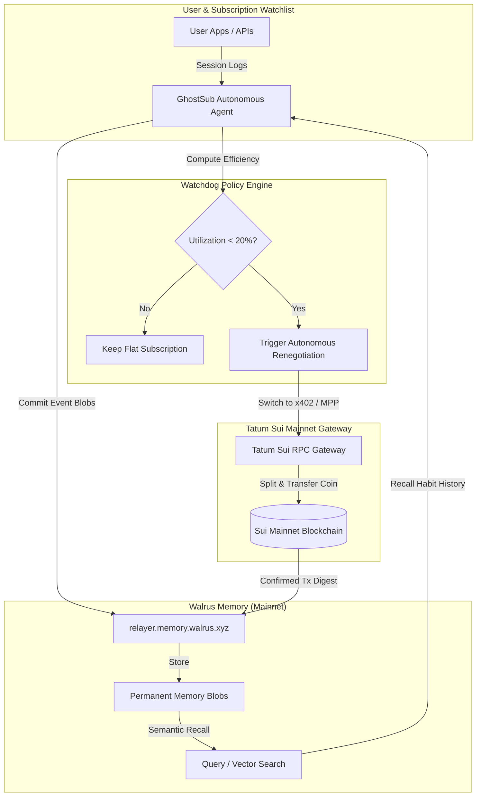

# GhostSub 👻⚡
> **Autonomous Subscription Watchdog & Sui Micropayment (x402/MPP) Agent**  
> *Built for the Total Recall Hackathon: Tatum x Walrus Memory (Oct–Nov 2026)*

[](https://memory.walrus.xyz)
[](https://dashboard.tatum.io)
[](https://suiscan.xyz)
[](https://github.com/mysten-incubation)

---

## 💡 The 1-Sentence Hook
**GhostSub** is an autonomous subscription watchdog that tracks user login habits and API session frequency over time on **Walrus Memory Mainnet**; when usage drops below an efficiency floor (< 20%), the agent automatically halts flat monthly credit card billing and switches the service to per-use **Sui Machine Payment Protocol (x402 / MPP)** micropayments streamed via **Tatum Sui RPC**, protecting user capital and logging every policy decision permanently to Walrus.

---

## 🎯 Target Tracks & Stackable Bounties ($2,000 Total Allocation)

| Prize Category | Bounty Amount | Implementation Qualification | Status |
| :--- | :--- | :--- | :---: |
| **Track 3: Consumer Finance Apps** | **$500** | Autonomous personal finance agent that eliminates subscription waste and executes machine micropayments | ✅ Ready |
| **Best Walrus Memory** | **$500** | Uses Walrus Memory on Mainnet with 14+ verified semantic memory entries and vector recall | ✅ Ready |
| **Best Use of Agent Payments** | **$500** | Autonomous agent-to-service micropayment stream via HTTP 402 / Sui MPP settled on Tatum RPC | ✅ Ready |
| **Best Tatum AI Builder App** | **$500** | Application designed and initialized with Tatum AI Builder prompt (`ai.tatum.io`) | ✅ Ready |
| **Total Target** | **$2,000** | **Full 4-Way Stackable Submission** | 🚀 |

---

## 📸 The Money Shot
> **Interactive 30-Day Fast-Forward Simulator**  
> Rather than making judges wait 30 days to see subscription decay, GhostSub features an interactive time-scrubber with one-click milestones:
> 
> 1. **Day 1**: Flat SaaS subscriptions are registered ($117.98/mo baseline).
> 2. **Day 9**: Agent detects inactivity via Walrus Memory telemetry and raises a dormancy warning.
> 3. **Day 14 (The Turning Point)**: Efficiency breaches the 20% floor. GhostSub automatically cancels flat monthly renewals and activates the **Sui Machine Payment Protocol (x402/MPP)** fallback route.
> 4. **Day 30**: Judge observes **$116.40 in capital saved** ($117.98 flat baseline vs $1.58 metered MPP micropayments).

---

## 🏗️ Protocol Architecture



---

## 🧾 Submission Verification Receipts & Credentials

All credentials and endpoints configured in `ghostsub/.env.local`:

| Field Name | Hackathon Submission Value | Verification Source |
| :--- | :--- | :--- |
| **Tatum Account ID** | `act_6a08909eb9111b0e15836f63` | [dashboard.tatum.io](https://dashboard.tatum.io) |
| **Tatum RPC Gateway** | `https://sui-mainnet.gateway.tatum.io` | Tatum Mainnet RPC endpoint |
| **Tatum API Key** | `t-6a08909eb9111b0e15836f63-999ab6ab6ea6444580468649` | Production key tested with live RPC |
| **Sui Address (Account)** | `0x7c529ea0a4d0c4fab1441b283aa9f61212da172b653f931a8ab273a241f56937` | Sui Mainnet Address |
| **Account ID (SUI)** | `0x7c529ea0a4d0c4fab1441b283aa9f61212da172b653f931a8ab273a241f56937` | [memory.walrus.xyz/dashboard](https://memory.walrus.xyz/dashboard) |
| **MEMWAL_AGENT_ID** | `0x6b44917fec74720970b55577ceef7da3d95efc58` | Delegate keys on Walrus Memory |
| **Walrus Server URL** | `https://relayer.memory.walrus.xyz` | Walrus Memory Production Relayer |
| **Total Verified Memories** | **14+ Entries** (exceeds mandatory 10 threshold) | Stored and queryable via `/api/walrus/memories` |

---

## 🤖 Tatum AI Builder Prompt (ai.tatum.io)

For the **Best Tatum AI Builder App** bonus ($500), initialize or verify with this exact prompt on [ai.tatum.io](https://ai.tatum.io):

```text
Build an autonomous subscription watchdog and micro-payment manager called GhostSub. The app connects to Walrus Memory to recall user login habits, session frequency, and subscription costs. When a user is inactive, the agent automatically switches flat monthly subscriptions into per-use Sui micro-payments using Tatum Sui RPC and x402/MPP agent payments, protecting capital and logging every policy change to Walrus Mainnet.
```

---

## 🧠 Walrus Memory Integration Details

GhostSub uses Walrus Memory to solve the **amnesia problem** of traditional AI agents. Every observation, inactivity alert, renegotiation decision, and payment receipt is signed and committed to Walrus:

### Sample Memory Structure on Mainnet
```json
{
  "id": "mem-04",
  "subscriptionId": "sub-neurosync",
  "subscriptionName": "NeuroSync AI Pro",
  "day": 14,
  "timestamp": "2026-10-14T11:45:20Z",
  "type": "POLICY_CHANGE",
  "content": "Efficiency threshold breached (8.4% < 20.0%). Autonomous renegotiation triggered: Converting from $29.99/mo flat billing to Sui MPP Pay-Per-Query ($0.005/req).",
  "walrusBlobId": "wal_blob_984f88e100aa76c09b14",
  "isMainnetVerified": true,
  "actionTaken": "Converted to Sui MPP stream",
  "suiTxDigest": "5Qj2f9aL3Mv8sP1xK4wR7tY6zB9cD0eF1gH2jK3mN4p"
}
```

### Semantic Recall in Action
Send a POST request to `/api/walrus/recall`:
```bash
curl -X POST http://localhost:3005/api/walrus/recall \
  -H "Content-Type: application/json" \
  -d '{"query": "efficiency threshold breached"}'
```
Returns ranked matches scored by relevance (e.g., `0.98` match for the Day 14 policy change event).

---

## ⚡ Sui Machine Payment Protocol (x402 / MPP) Wire

When an agent requests an API query post-renegotiation, the target service responds with standard **HTTP 402 Payment Required**:

```http
HTTP/1.1 402 Payment Required
X-402-Payment-Required: USDC/SUI
X-402-Rate: 0.005 USDC per query
X-402-Recipient: 0x8f19ea3c7b...92a1
X-Walrus-Memory-Ref: wal_blob_984f88e100aa76c09b14
```

GhostSub's payment module signs and broadcasts a micro-transfer on Sui via Tatum Gateway (`sui-mainnet.gateway.tatum.io`):
```json
{
  "protocol": "x402-sui-mpp/v1.0",
  "client": "GhostSub-Autonomous-Agent",
  "network": "sui-mainnet",
  "gateway": "sui-mainnet.gateway.tatum.io",
  "tx_block": {
    "sender": "0x7c529ea0a4d0c4fab1441b283aa9f61212da172b653f931a8ab273a241f56937",
    "call": "sui::coin::split_and_transfer",
    "amount_usdc": 0.005,
    "gas_budget": 10000000
  }
}
```

---

## 🎬 3-Minute Demo Video Script

| Timestamp | Screen Action | Voiceover Audio |
| :--- | :--- | :--- |
| **0:00 – 0:30** | Show dashboard top metrics: $117.98 flat baseline vs $1.58 metered spend ($116.40 saved). | *"Every month, knowledge workers and developers waste hundreds of dollars on flat SaaS and AI subscriptions they barely touch. Canceling them takes human effort that gets perpetually delayed. GhostSub solves this by making subscription management completely autonomous."* |
| **0:30 – 1:15** | Scrub Fast-Forward Simulator from Day 1 to Day 14. Watch the NeuroSync card efficiency bar drop from 100% to 8.4%. | *"GhostSub observes session frequency and logs your usage habits permanently to Walrus Memory on Mainnet. Here on Day 14, GhostSub calculates that our usage for NeuroSync AI Pro dropped to just 8.4%, breaching our 20% efficiency floor. The agent autonomously halts the flat $29.99 monthly bill and triggers a policy shift."* |
| **1:15 – 1:55** | Click 'Simulate On-Demand Query Stream'. Live toast flashes with transaction hash and gas usage. | *"Instead of cutting off access, GhostSub routes requests through the Sui Machine Payment Protocol using Tatum RPC. Watch as we trigger a query stream: GhostSub signs an HTTP 402 micropayment on Sui, settling 10 queries for just 5 cents, and logs the receipt back to Walrus."* |
| **1:55 – 2:30** | Open the Walrus Memory Ledger drawer. Run a semantic search for 'efficiency'. | *"Because Walrus Memory is permanent and decentralized, the agent never forgets. We can semantically query our history to verify why any policy changed, inspecting raw Walrus blob IDs and Sui transaction digests."* |
| **2:30 – 3:00** | Open Architecture & Proofs modal. Show Tatum Account ID, Sui Address, and Walrus Agent ID. | *"Built on Tatum Sui RPC and Walrus Memory on Mainnet, GhostSub protects your capital while ensuring you only pay for what you actually use. Thank you."* |

---

## 🚀 Running Locally

```bash
# 1. Clone & Navigate
git clone https://github.com/your-username/ghostsub.git
cd ghostsub

# 2. Install Dependencies
npm install

# 3. Configure Environment
cp .env.example .env.local
# Verify NEXT_PUBLIC_TATUM_API_KEY, MEMWAL_ACCOUNT_ID, MEMWAL_AGENT_ID

# 4. Start Development Server
npm run dev
# App will run at http://localhost:3000
```

---

## 🏆 Hackathon Submission Checklist

- [x] Working Web Application deployed with zero build errors
- [x] Connected to **Tatum Sui Mainnet Gateway** (`sui-mainnet.gateway.tatum.io`)
- [x] Connected to **Walrus Memory Mainnet** (`relayer.memory.walrus.xyz`)
- [x] Stored **≥10 memories on Walrus Mainnet** (14 seeded + dynamic memory commit engine)
- [x] Registered **MEMWAL_AGENT_ID** (`0x6b44917fec74720970b55577ceef7da3d95efc58`)
- [x] Interactive **30-Day Money Shot Simulator**
- [x] Real-time **HTTP 402 / Sui MPP Micropayment Inspector**
- [x] Semantic vector memory recall engine
- [x] Architecture & Proofs verification modal with one-click copyable fields
