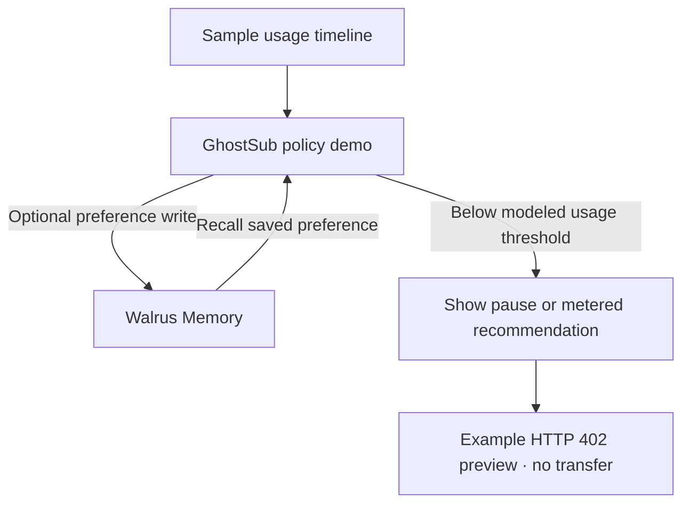

# GhostSub 👻⚡
> **Subscription usage and billing policy walkthrough**
> *Built for the Total Recall Hackathon: Tatum x Walrus Memory (Oct–Nov 2026)*

[](https://memory.walrus.xyz)
[](https://dashboard.tatum.io)
[](https://suiscan.xyz)
[](https://github.com/mysten-incubation)

---

## 💡 The 1-Sentence Hook
**GhostSub** explores how a usage-aware finance agent could remember a person's billing preferences, spot an underused API subscription, and recommend either a pause or a metered route. This build contains an interactive sample timeline, a real Walrus preference write/recall path when server credentials are configured, and an HTTP 402 preview; it does not cancel a real plan or send a Sui payment.

---

## 🎯 Target Track & Special Awards

| Prize Category | Bounty Amount | Implementation Qualification | Status |
| :--- | :--- | :--- | :---: |
| **Track 3: Consumer Finance Apps** | **$1,000 track pool** | Track placements: $500 / $300 / $200 | Target |
| **Best Walrus Memory** | **$500 special award** | Memory should visibly change the product's behavior | Demo loop implemented |
| **Best Tatum AI Builder App** | **$500 special award** | App built primarily with Tatum AI Builder | Optional |
| **Best Use of Agent Payments** | **$500 special award** | Requires a real agent payment implementation | Not implemented; preview only |

---

## 📸 The Money Shot
> **Interactive 30-Day Sample Walkthrough**
> The timeline is illustrative and is not a record of real subscription activity or payments:
> 
> 1. **Day 1**: The sample timeline begins with one flat API subscription.
> 2. **Day 9**: The sample usage declines and surfaces an inactivity warning.
> 3. **Day 14 (The Turning Point)**: The usage scenario falls below the 20% floor. A saved user preference changes the recommendation: keep access with metered billing, or pause the flat plan.
> 4. The savings numbers are modeled estimates. The request preview does not transfer funds.

---

## 🏗️ Protocol Architecture



## 🧾 Integration Status

Environment configuration is documented in `.env.example`; values are intentionally not published in this README. The active local demo profile currently recalls 10 Walrus Mainnet blob receipts: one earlier payment-preview event and nine clearly labeled synthetic policy scenarios. Each write was marked verified only after Walrus returned its real blob ID. The scenarios are examples, not claims about the account owner's actual preferences. Tatum status is a read-only checkpoint query, and payment settlement remains a preview with no Sui transaction.

---

## 🤖 Tatum AI Builder Prompt (ai.tatum.io)

For the **Best Tatum AI Builder App** bonus ($500), adapt this prompt if you build the prototype with Tatum AI Builder:

```text
Build GhostSub, a subscription policy prototype. Let a user choose whether to preserve access with metered billing or pause an idle flat plan. Store and recall that preference with Walrus Memory, evaluate it against a clearly labeled sample usage timeline, and display an example HTTP 402 payment request. Do not claim subscription cancellation or payment settlement unless those integrations are implemented and verified.
```

---

## 🧠 Walrus Memory Integration Details

When server-side Walrus credentials are configured, the demo saves the selected billing preference through `rememberAndWait` and recalls it by browser-local profile namespace after reload. Example timeline records are not Walrus receipts.

### Illustrative Preference Memory
```json
{
  "type": "USER_PREFERENCE",
  "subscriptionId": "sub-neurosync",
  "subscriptionName": "NeuroSync AI Pro",
  "content": "GHOSTSUB_PREFERENCE_V1: keep_access\\nKeep API access available; recommend metered billing below the 20% floor."
}
```

### Semantic Recall in Action
Send a POST request to `/api/walrus/recall` with the browser-local profile ID:
```bash
curl -X POST http://localhost:3000/api/walrus/recall \
  -H "Content-Type: application/json" \
  -d '{"query": "billing preference", "profileId": "your-browser-profile-id"}'
```
Returns semantic matches from that profile's Walrus namespace. It returns an error when Walrus is not configured; it does not fall back to fake vector scores.

---

## ⚡ Sui Machine Payment Protocol (x402 / MPP) Wire

The x402 panel shows an illustrative **HTTP 402 Payment Required** shape only:

```http
HTTP/1.1 402 Payment Required
Content-Type: application/json

{"status":"example only","price":"0.005 USDC / query","settlement":"not sent by this preview"}
```

This build does not sign or broadcast a payment. A live flow still needs a real service recipient, token type, wallet connection, and explicit wallet approval.

---

## 🎬 3-Minute Demo Video Script

The current recording plan is in [`DEMO_SCRIPT.md`](./DEMO_SCRIPT.md). It includes the synthetic-data disclosure and avoids making an extra Walrus write during recording.

| Timestamp | Screen Action | Voiceover Audio |
| :--- | :--- | :--- |
| **0:00 – 0:30** | Introduce the problem and clarify that the displayed usage timeline is sample data. | *"Unused API subscriptions are hard to spot and easy to postpone. GhostSub explores a usage-aware finance agent that remembers the user's policy before recommending what to do."* |
| **0:30 – 1:15** | Set a billing preference, save it to Walrus, then reload and show it recalled. Scrub to Day 14. | *"This preference is written to Walrus Memory and recalled in this browser profile. When the sample usage drops below its floor, that remembered preference changes the recommendation."* |
| **1:15 – 1:55** | Toggle between keep-access and pause-when-idle; show the decision and the HTTP 402 preview. | *"Keeping access recommends a metered route; pausing idle service recommends stopping the flat plan. The payment panel is a protocol preview only; no Sui transfer occurs in this build."* |
| **1:55 – 2:30** | Open the Walrus Memory Ledger and search for the saved policy. | *"Verified entries link to their real Walrus blob IDs. Seeded walkthrough records are labeled as examples and are not presented as chain receipts."* |
| **2:30 – 3:00** | Show Tatum RPC status and the architecture view; distinguish implemented reads from planned settlement. | *"The demo currently reads Tatum Sui network status and persists preferences through Walrus Memory. A wallet-approved payment flow is the next integration step."* |

---

## 🚀 Running Locally

```bash
# 1. Clone & Navigate
git clone https://github.com/ritesh59697/ghostsub.git
cd ghostsub

# 2. Install Dependencies
npm install

# 3. Configure Environment
cp .env.example .env.local
# Configure server-only TATUM_API_KEY, MEMWAL_PRIVATE_KEY, MEMWAL_ACCOUNT_ID, and MEMWAL_AGENT_ID

# 4. Start Development Server
npm run dev
# App will run at http://localhost:3000
```

---

## 🏆 Hackathon Submission Checklist

- [x] Interactive sample walkthrough and public source code
- [x] Walrus preference save and semantic recall paths; these require valid server credentials
- [x] Confirm 10 Walrus Mainnet writes; verified blob IDs are visible in the Memory Ledger
- [x] Publish the required blog post describing what was built and how memory changes behavior ([`BLOG_POST.md`](./BLOG_POST.md))
- [x] Prepare a timed walkthrough recording plan ([`DEMO_SCRIPT.md`](./DEMO_SCRIPT.md))
- [ ] Implement an actual wallet-approved Sui settlement before claiming x402/MPP payments
- [x] Publish the blog post
- [ ] Replace its demo placeholder with the public demo URL after deployment
- [x] Deploy the demo and verify Tatum RPC and Walrus health responses in Production: https://ghostsub-cyan.vercel.app/demo
- [ ] Record and publish the 2–3 minute walkthrough
- [ ] Optional: build primarily with Tatum AI Builder to compete for its special award
